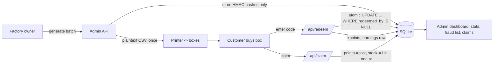

# Architecture
## Stack and why
- **Python stdlib + SQLite**: zero dependencies, runs anywhere with one command, easy to explain line by line. SQLite gives real transactions, which the anti-fraud logic depends on. Trade-off: single-server scale; migrate to Postgres + a framework (FastAPI) if traffic grows.
- **Vanilla JS single page**: no build step; all user text is HTML-escaped.

## Diagram

## Data model
products(id, name, points) · batches(id, product_id, qty, created_at) · codes(**hash PK**, batch_id, redeemed_by, redeemed_at) · customers(id, name, email UNIQUE, salt, scrypt pw, points>=0) · earnings(customer, product, points, time) · rewards(id, name, cost, stock>=0, active) · claims(customer, reward, cost, time) · attempts(kind, key, ok, time) · sessions(token hash, role, cid, expires)

## Fraud/reuse defences
1. Single-use is enforced by one atomic SQL `UPDATE ... WHERE redeemed_by IS NULL`; concurrent requests cannot both succeed (tested with 8 threads).
2. Codes are random (secrets module), 1.1e18 space, stored only as HMAC.
3. Per-account lockout on repeated bad codes; identical error for unknown/used.
4. Admin dashboard lists accounts with 3+ failures in 24h; every attempt is logged.
5. Passwords: scrypt + salt; sessions: random token, only hash stored, HttpOnly SameSite=Strict cookie; JSON-only POSTs.
6. DB CHECK constraints keep points/stock non-negative even if app logic fails.

## Tests (`tests/test_app.py`, all pass)
valid redeem; reuse by same/other user; concurrent redeem; lockout; no plaintext in DB; claim needs points; admin routes protected; admin stats.
